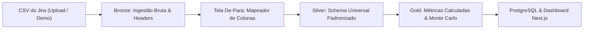

# SprintLens 🔍📊

> **Plataforma SaaS de People & Agile Analytics baseada em exportações do Jira**  
> *Mapeamento dinâmico de contratos de dados, métricas ágeis universais e simulação preditiva de Monte Carlo.*

---

## 1. Visão Geral da Arquitetura

O SprintLens foi desenhado sob uma arquitetura de **Monorepo** moderna com separação clara de responsabilidades entre interface analítica, orquestração transacional/RBAC e motor científico de dados.

```
sprintlens/
├── docker-compose.yml       # PostgreSQL 16 local + pgAdmin 4 (ferramenta opcional)
├── .env.example             # Variáveis de ambiente centralizadas de referência
├── .gitignore               # Configurações de exclusão de artefatos temporários
├── package.json             # Scripts de orquestração do monorepo
├── pnpm-workspace.yaml      # Definição dos workspaces do Monorepo
├── scripts/                 # Scripts de bootstrap e utilitários
│   ├── init-env.ps1         # Script de setup local (PowerShell)
│   └── init-env.sh          # Script de setup local (Bash / Unix)
└── apps/
    ├── web/                 # Frontend: Next.js 14+ (App Router, TailwindCSS, shadcn/ui)
    ├── api-core/            # Backend: NestJS (TypeScript, Prisma ORM, JWT, RBAC)
    └── data-engine/         # Microsserviço de Dados: Python 3.11+ (FastAPI, Pandas, NumPy)
```

---

## 2. Tecnologias Utilizadas

| Camada | Tecnologia | Propósito |
| :--- | :--- | :--- |
| **Frontend** | Next.js 14+ (App Router) & TypeScript | Dashboard responsivo, wizards de upload, renderização e exportação de relatórios |
| **Design System** | Tailwind CSS + shadcn/ui + Lucide Icons | Interface corporativa limpa (*Light Mode*, paleta `#537EED` e `#FFFFFF`) |
| **Visualização** | Apache ECharts / Recharts | Gráficos de alta performance com paleta customizável reativamente |
| **Backend Core** | NestJS & Prisma ORM | Autenticação JWT, controle de acesso RBAC, gestão de projetos e ponte de dados |
| **Banco de Dados** | PostgreSQL 16 (Docker) | Armazenamento relacional de usuários, permissões, projetos e métricas |
| **Data Engine** | Python 3.11, FastAPI, Pandas, NumPy | Pipeline Medallion (Bronze/Silver/Gold) e Simulação de Monte Carlo (10.000 iterações) |

---

## 3. Identidade Visual e Filosofia de Design

- **Fundo Principal:** `#FFFFFF` (Branco Puro)
- **Fundo Secundário (Cards):** `#F8FAFC` (Cinza Gelo) com bordas sutis `#E2E8F0`
- **Cor Primária (Destaque Principal):** `#537EED` (Brand Blue)
- **Cor Secundária (Contexto / Comparação):** `#1E3A8A` (Navy Blue) ou `#94A3B8`
- **Cor de Alerta / Bugs:** `#EF4444` (Coral Red)
- **Tipografia:** *Inter* / *Plus Jakarta Sans*

---

## 4. Pipeline de Dados (Medallion Architecture)



### Contrato de Dados (Schema Universal)
- **Silver:** `issue_key`, `issue_type`, `status`, `priority`, `assignee`, `created_at`, `updated_at`, `resolved_at`, `sprint`, `story_points`, `time_spent_sec`, `original_estimate_sec`.
- **Gold:** `lead_time_days`, `days_since_update`, `is_bug`, `is_completed`.

---

## 5. Pré-requisitos de Desenvolvimento Local

- **Node.js** >= 20.x (`node -v`)
- **pnpm** >= 9.x (`pnpm -v`)
- **Python** >= 3.11 (`python --version`)
- **Docker** e **Docker Compose** (`docker-compose --version`)

---

## 6. Inicialização do Ambiente Local (Etapa 1)

### 1. Clonar e inicializar variáveis de ambiente
```powershell
# PowerShell (Windows)
.\scripts\init-env.ps1

# Ou Bash (Linux/Mac/WSL)
./scripts/init-env.sh
```

### 2. Iniciar o Banco de Dados PostgreSQL Local
```bash
# Iniciar apenas o container do PostgreSQL em segundo plano
docker-compose up -d postgres

# Ou via script npm/pnpm
pnpm docker:up
```

*(Opcional)* Para iniciar também o **pgAdmin 4** na porta `5050`:
```bash
docker-compose --profile tools up -d
```

### 3. Verificar status do serviço
```bash
docker-compose ps
```

---

## 7. Roadmap de Implementação

- [x] **Etapa 1: Setup & Infraestrutura Local** (Monorepo, .gitignore, Docker Compose, .env.example, scripts)
- [ ] **Etapa 2: Backend Core & Auth** (NestJS, Prisma ORM, JWT, RBAC, Seed Admin, CRUD Admin)
- [ ] **Etapa 3: Data Engine Python** (FastAPI, Pandas ETL Medallion, dataset demo, Monte Carlo 10k)
- [ ] **Etapa 4: Frontend Base & Auth** (Next.js 14, Tailwind, Design System, telas Auth, Admin)
- [ ] **Etapa 5: Fluxo de Upload, Mapeador De-Para, Dashboard e Exportação PDF**
